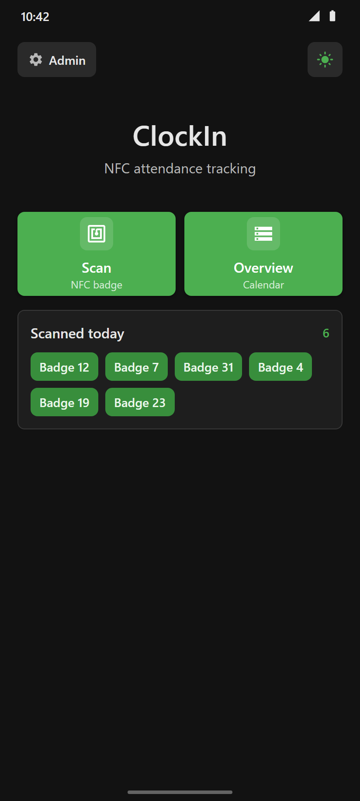
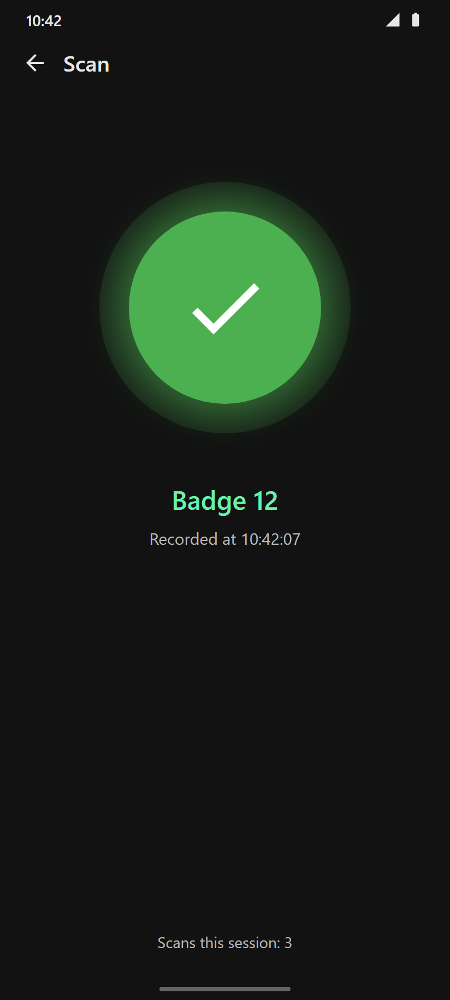
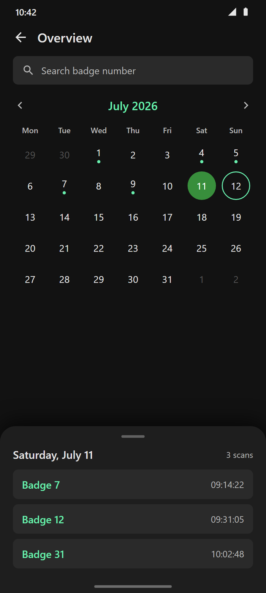
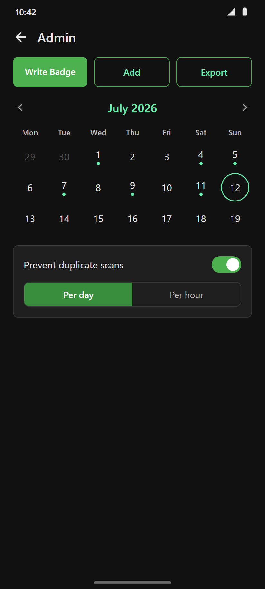
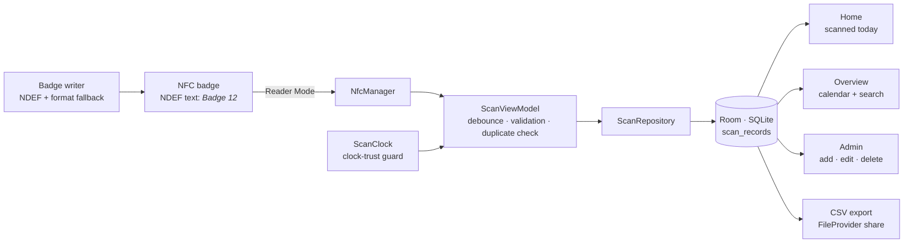

<div align="center">

# ⏱️ ClockIn

### Tap in. You're on the clock.

A self-hosted **NFC clock-in & attendance system** for Android. Mount a spare phone by the door,
hand everyone an NFC badge, and every tap is logged to a local database — **no accounts, no cloud,
no subscription, no internet.**

[](https://kotlinlang.org/)
[](https://developer.android.com/jetpack/compose)
[](https://developer.android.com/training/data-storage/room)
[](https://developer.android.com/)
[](https://github.com/xfznprojects/ClockIn/actions)
[](LICENSE)

&nbsp;&nbsp;


</div>

---

## Overview

ClockIn turns any NFC-capable Android phone (Android 9+) into a **standalone attendance kiosk**:

1. **Write a badge** — the app writes a badge number to any cheap NFC tag (stickers, cards, key fobs).
2. **Tap to clock in** — holding a badge against the phone records *who* and *when* with a confirmation
   beep and a big green check.
3. **Review & export** — a calendar shows every day with activity; admins can search, backfill,
   correct records, and export the full history as CSV.

It was built for real-world unattended use: continuous **NFC Reader Mode** scanning, debounce against
double-reads, optional duplicate blocking, a PIN-gated admin area, and a **clock-trust guard** that
detects unreliable system time before it can corrupt records — a real concern on old kiosk phones with
dead RTC batteries.

## ✨ Highlights

| | |
| --- | --- |
| 📴 **Offline by design** | The app requests **zero network permissions** — attendance data physically cannot leave the device. Cloud backup is disabled too. |
| ⚡ **Kiosk-grade scanning** | NFC Reader Mode with custom feedback beep, 1.5 s debounce, and race-safe scan handling. Scan all day without touching the screen. |
| 🔁 **Duplicate prevention** | Optionally block repeat scans of the same badge **per day** or **per hour** — configurable in-app. |
| 🗓️ **Calendar overview** | Month view with activity dots; tap a day for its full scan list. Locale-aware month and weekday names. |
| 🔐 **PIN-gated admin** | Add, correct, or delete records; search by badge; all destructive actions require confirmation. |
| ✍️ **Writes its own badges** | Built-in NDEF writer with overwrite detection — no third-party tag app needed. Works with NTAG213/215/216 and any NDEF text tag. |
| 📤 **CSV export** | One tap shares the complete history as a CSV attachment via any email/share app, with a per-day summary in the body. |
| 🕰️ **Clock-trust guard** | Validates system time before every scan; falls back to an elapsed-time estimate or a manually confirmed date rather than logging garbage timestamps. |
| 🌗 **Dark & light theme** | Material 3 throughout, defaulting to a kiosk-friendly dark theme. |

## 🖼️ A tour

<table>
<tr>
<td width="50%"><br/><b>Overview</b> — month calendar with activity dots, badge search, and a bottom sheet listing every scan of the selected day.</td>
<td width="50%"><br/><b>Admin</b> — write new badges, backfill or correct records, export CSV, and configure duplicate prevention. PIN-protected.</td>
</tr>
</table>

## 🏗️ How it works



- **Badges are plain NDEF text records** (`Badge 12`) — no proprietary format, readable by any NFC app,
  and cheap NTAG stickers work fine.
- **Every record stores** the date, badge number, wall-clock time, and an epoch timestamp used for
  ordering — manual/backfilled entries derive their timestamp from the entered date and time, so
  history always sorts correctly.
- **`ScanClock`** refuses to trust an obviously wrong system clock. It estimates the current time from
  the last known-good clock plus elapsed uptime (reboot-aware), and as a last resort asks the operator
  to confirm today's date — advancing it automatically across midnights.

A deeper dive lives in [ARCHITECTURE.md](ARCHITECTURE.md).

## 🧰 Tech stack

**App** — Kotlin 1.9, Jetpack Compose (Material 3), Navigation Compose, Room 2.6 (KSP), Kotlin
Coroutines + StateFlow, Android NFC Reader Mode API, `java.time` everywhere.
**Build & CI** — Gradle (Kotlin DSL), GitHub Actions building a debug APK on every push/PR.
**Architecture** — single-activity Compose app, ViewModel + Repository + DAO layers, manual
constructor injection (the app is deliberately small enough not to need a DI framework).

## 🚀 Getting started

**Prerequisites:** JDK 17 and the Android SDK (API 34), or just Android Studio.

```bash
git clone https://github.com/xfznprojects/ClockIn.git
cd ClockIn
./gradlew assembleDebug          # APK → app/build/outputs/apk/debug/app-debug.apk
```

Install on the kiosk phone:

```bash
adb install -r app/build/outputs/apk/debug/app-debug.apk
```

…or copy the APK to the phone and tap it (enable *Install unknown apps* for your file manager).
The phone needs **NFC hardware** — the app won't install without it.

### Set up your station

1. Open **Admin** (gear chip, top-left) — default PIN is `0000`.
2. **Write Badge** → enter a number → hold a blank NFC tag against the phone. Repeat per person/station.
3. Optionally enable **Prevent duplicate scans** (per day or per hour).
4. Mount the phone, plug it in, set display timeout to something generous — done. People just tap.

### Configuration

| Setting | Where | Default |
| --- | --- | --- |
| Admin PIN | `util/Constants.kt` → `ADMIN_PIN` — **change before deploying** | `0000` |
| Scan debounce | `util/Constants.kt` → `NFC_READER_DEBOUNCE_MS` | `1500` ms |
| Duplicate blocking | In-app: Admin → Settings | off |
| Theme | In-app toggle, persisted | dark |

## 🔒 Data & privacy

- **No network access.** The manifest requests only `android.permission.NFC`. There is no telemetry,
  no analytics, no cloud — nothing to configure and nothing to leak.
- **No Android cloud backup** (`allowBackup=false`): attendance data stays on the device until *you*
  export it.
- **Export is explicit**: CSV files are generated on demand into app-private cache and shared through
  Android's standard share sheet via `FileProvider`.

## 📁 Project structure

```
app/src/main/java/com/clockin/app/
├── MainActivity.kt              # single activity, NFC launch handling
├── ClockInApp.kt                # Application: lazy DB / prefs / clock
├── data/
│   ├── local/                   # Room entity, DAO, database, preferences
│   └── repository/              # ScanRepository (search escaping, duplicate checks)
├── nfc/
│   └── NfcManager.kt            # Reader Mode read/write, NDEF parsing, format fallback
├── ui/
│   ├── components/              # scan indicator, record cards
│   ├── navigation/              # routes + NavHost + PIN gate + resume refresh
│   ├── screens/
│   │   ├── home/                # landing screen, today's scans
│   │   ├── scan/                # scan UI + ViewModel (debounce, races, duplicates)
│   │   ├── database/            # calendar overview + search
│   │   └── admin/               # admin, badge writer, CSV export, PIN dialog
│   └── theme/                   # Material 3 dark/light schemes
└── util/                        # ScanClock, date/time (strict java.time), badge utils
```

## 🤝 Contributing

Issues and PRs are welcome — see [CONTRIBUTING.md](CONTRIBUTING.md) for build instructions and
guidelines.

## 📄 License

[GPL-3.0](LICENSE) © xfznprojects

Free to use, modify, and share — but if you distribute ClockIn or anything built from it, your
version must stay open source under the same license, with credit to the original.

<sub>Screens shown above are illustrative renders of the app UI.</sub>
